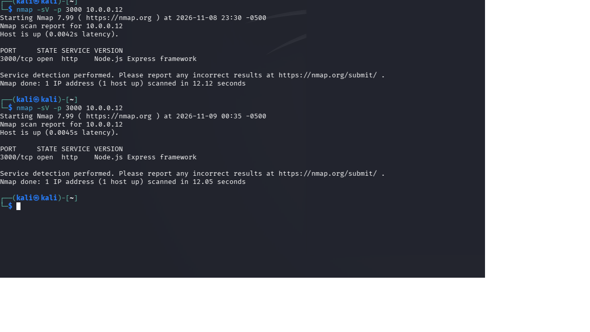

# Network Reconnaissance — Nmap

## 1. Objective

The purpose of this test was to perform network reconnaissance against my own Node.js Express web application.

I wanted to verify that my Windows desktop was reachable from my Kali Linux virtual machine and identify the service running on TCP port 3000.

## 2. Lab Environment

| Component | Configuration |
|---|---|
| Testing machine | Kali Linux VM |
| Virtualization | Oracle VirtualBox (NAT) |
| Target machine | Windows desktop |
| Target IP address | 10.0.0.12 |
| Target port | TCP 3000 |
| Web application | Node.js / Express |

Both computers were connected through my home network, with a Windows Firewall rule configured to permit access from my testing laptop.

## 3. Tool Used — Nmap

Nmap (Network Mapper) is an open-source tool used for network discovery and security auditing.

It can identify reachable hosts, open ports, and services running on network devices.

For this test, I used Nmap to identify the HTTP service running on my Windows desktop.

## 4. Command Executed

```bash
nmap -sV -p 3000 10.0.0.12
```

**Command breakdown:**

- `nmap` — Starts the network scanner.
- `-sV` — Attempts to identify the service and its version.
- `-p 3000` — Limits the scan to TCP port 3000.
- `10.0.0.12` — Specifies my Windows desktop as the target.

## 5. Scan Results

Nmap successfully detected the target host and identified an open TCP port.

```text
Nmap scan report for 10.0.0.12
Host is up (0.0042s latency).

PORT     STATE SERVICE VERSION
3000/tcp open  http    Node.js Express framework
E
Nmap done: 1 IP address (1 host up)
scanned in 12.12 seconds
```

I performed the scan twice, and both scans returned the same port state and service identification.

| Finding | Result |
|---|---|
| Host status | Up |
| Port | 3000/tcp |
| Port state | Open |
| Service | HTTP |
| Technology identified | Node.js Express framework |


## 6. Screenshot Evidence

The screenshot below shows two Nmap scans performed
against my Node.js Express web server.


