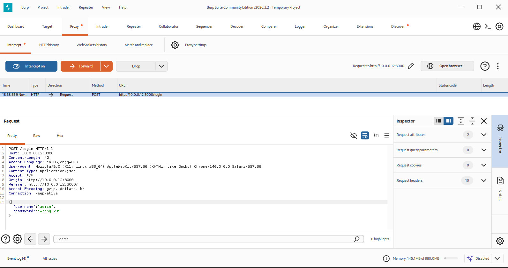

# Web Application Security Testing — Burp Suite

## 1. Objective

The purpose of this test was to inspect HTTP login requests sent from my Kali Linux VM to my Node.js Express web application.

I wanted to understand how Burp Suite intercepts requests and how my backend processes authentication attempts.

## 2. Lab Environment

| Component | Configuration |
|---|---|
| Testing machine | Kali Linux VM |
| Target machine | Windows desktop |
| Web application | Node.js / Express |
| Target address | 10.0.0.12:3000 |
| Testing tool | Burp Suite Community Edition |

## 3. Tool Used — Burp Suite

Burp Suite is a web application security testing tool that allows testers to intercept, inspect, and modify HTTP requests and responses.

For this test, I used Burp's Proxy feature to observe communication between my browser and Express server.

## 4. Testing Procedure

1. Started Burp Suite Community Edition inside Kali Linux.
2. Opened Burp's built-in browser.
3. Navigated to my local Express application.
4. Enabled interception in Burp Proxy.
5. Submitted fictional login credentials.
6. Inspected the intercepted HTTP request.

## 5. Screenshot Evidence

## 6. Initial Observations

The login form sends credentials to the `/login` endpoint using an HTTP POST request.

The request body uses JSON to transmit the submitted username and password.

Burp Suite allows me to inspect this information before the request reaches the Express backend.

## 7. Next Steps

- Inspect the server's HTTP response.
- Compare the request against the application's security logs.
- Use Burp Repeater to modify and resend a test request.
- Document the results and security implications.